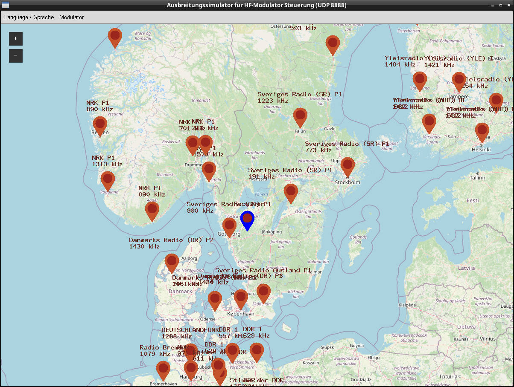
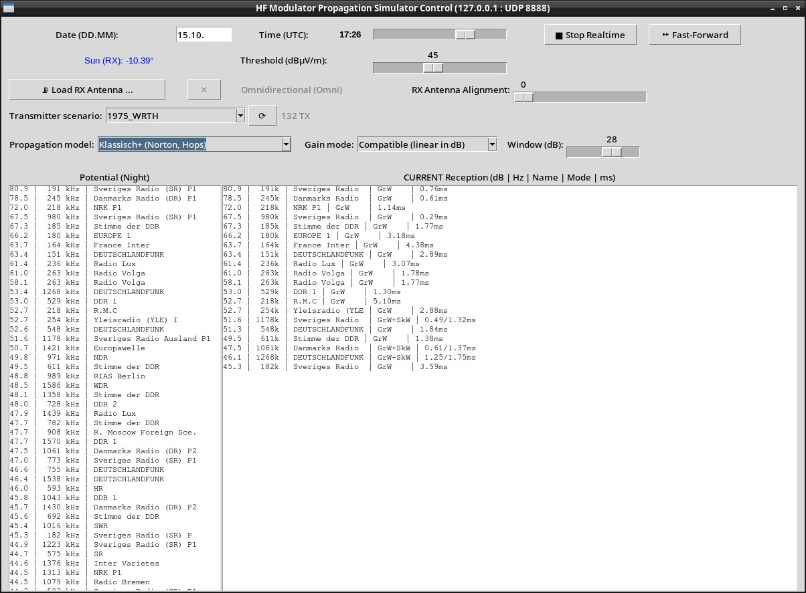
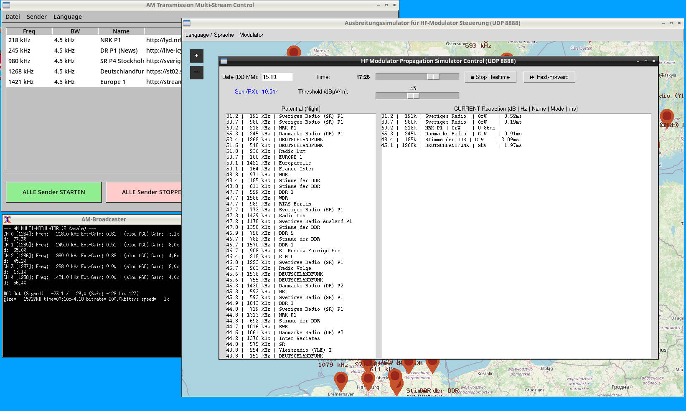
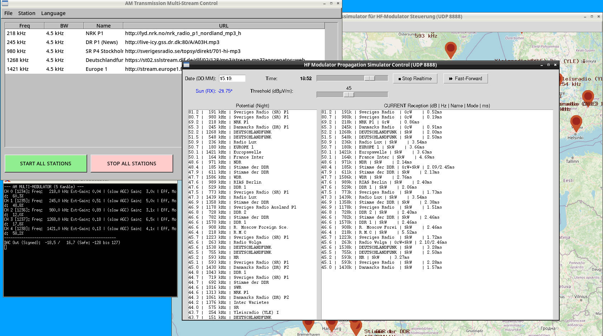
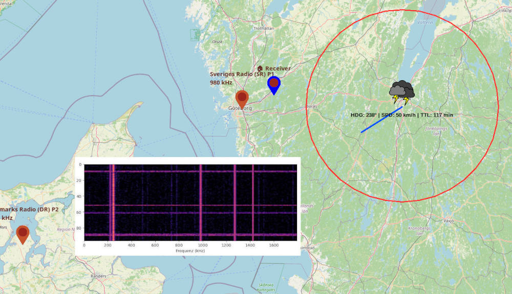
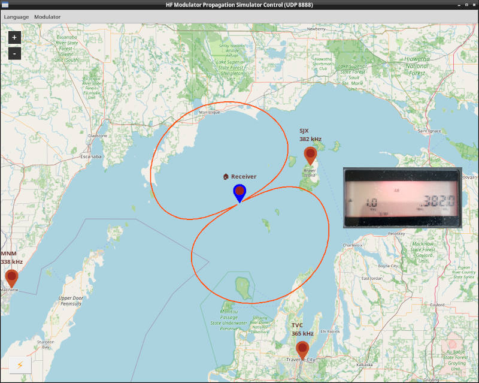
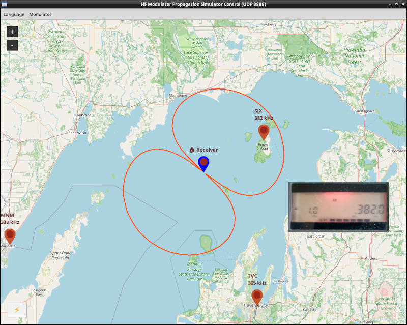
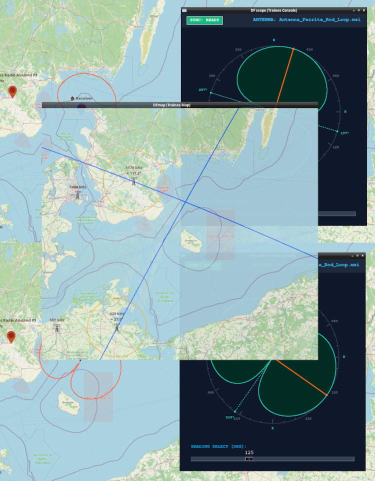
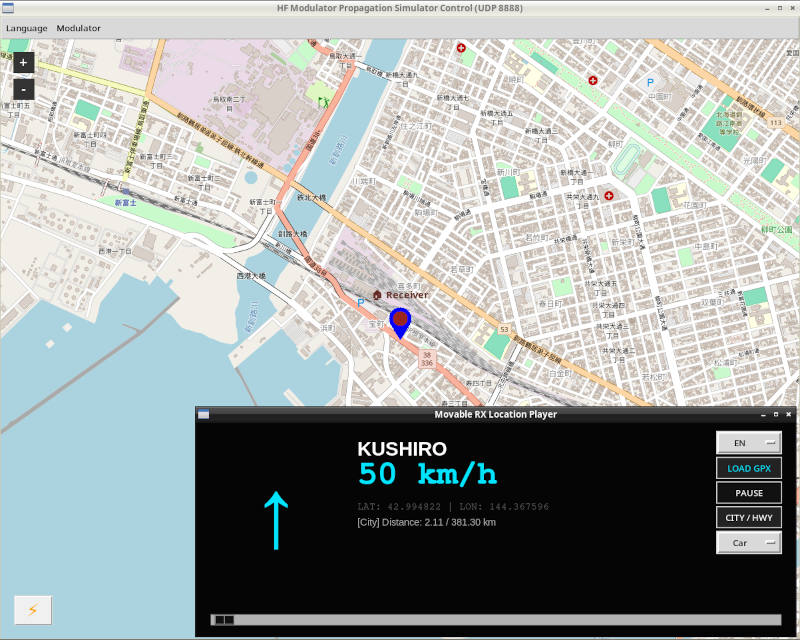
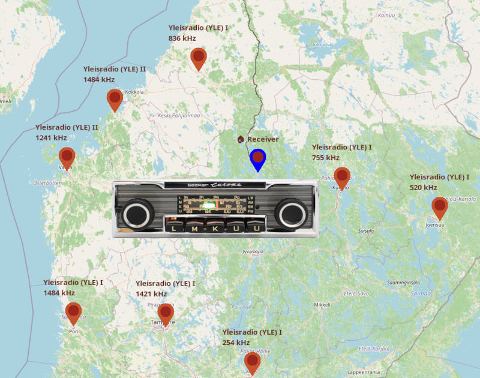

### AMWaveSynth/COHI-Player-Universal-addon for dynamic control of signal amplitudes based on annual and daily propagation conditions.


Based on transmitter data such as location and transmission power, which can be obtained, for example, from older WRTH, 
receiver positions can be defined using a map. At these receiver locations, the conditions of ground and sky waves can be simulated 
according to simplified models ITU-R P.368-10 / ITU-R P.1147-2, varying by year and time of day. 
The resulting data can be used in time-lapse or real-time to control the artificial carriers of the AMWaveSynth and COHI-Player-Universal modulator, providing an 
even more realistic representation of the transmitted signal at specific times of day.


WRTH 1975 scenario on LW and MW

The radiosignals transmitted by the AMWaveSynth or COHI-Player-Universal creates the impression of an active twilight zone and a day and night scene of the synthetically created radio wave bands.





The current status is displayed directly in the simulation window. Additionally, a threshold value for the radio's reception sensitivity can be specified to further filter 
the actually receivable stations.


Simulation, afternoon of October 15th, 17:26



Simulation, afternoon of October 15th, 18:52 , foreign radio stations can now also be received via skywave on radios powered by the AMWaveSynth.

Transmitter definitions are stored as CSV files in **scenario folders** below `tx_sites/`, e.g. `tx_sites/1975_WRTH/`, `tx_sites/Testlandschaft_xyz/` (any name; folders starting with `.` or `_` are ignored). Each CSV line is one transmitter site: location, country code, frequency in kHz, transmission power in kW, and call/name of radiostation. All CSVs of a folder together form one scenario.
The scenario can be switched at runtime with the drop-down "Senderlandschaft / Transmitter scenario" in the simulation window (⟳ rescans the folders and reloads the current scenario). No restart is needed; the last choice is remembered in `app_config.json`. Transmitters of the old scenario are muted on the modulator (gain 0.0) automatically.
Locations are resolved to GPS coordinates using ArcGIS and cached in one central SQL database (`geocache_radio.db`) shared by all scenarios, so it only grows with new names. Transmitter and receiver locations are displayed using a TkinterMapView.

### Propagation models (switchable at runtime)

The physics lives in `propagation_models/`; the drop-down "Ausbreitungsmodell / Propagation model" switches the model without restart (stations that fall silent are muted on the modulator automatically).

* **Klassisch (heuristisch)** - the original simplified model (results identical to earlier versions, including full antenna directivity on the sky wave).
* **Klassisch+ (Norton, Hops)** - the classic model with modified physics but the same dusk/dawn behaviour (bands open from the top down): Norton ground wave with ground conductivity, great-circle distance, continuous multi-hop sky wave (extra loss per additional 2000 km hop), optional 1/(f+fL)² D-layer absorption and a cap of the daytime absorption on LW. `fL`, hop loss, LW cap and `SKY_OFFSET_DB` are estimates; all constants are at the top of `enhanced.py`.
* **ITU-R P.1147-2 (mit Jahreszeiten)** - sky wave after ITU-R P.1147-2 (geomagnetic loss, hour factor around sunset/sunrise, daytime loss), ground wave after Norton (flat earth).
  * **Seasons:** P.1147-2 gives the annual median and describes seasonal behaviour only in words, without a formula. The model therefore adds a *parametric* correction (zero mean over the year): MF at night strongest in spring/autumn, weakest in summer/winter (summer minimum deeper), swing 15 dB at 530 kHz decreasing to 3 dB at 1700 kHz; LF at night summer maximum (8 dB peak-to-peak - an assumption, the text gives no value); MF at midday winter maximum (winter mean about +10 dB); much smaller in the tropics, seasons mirrored on the southern hemisphere. Amplitudes follow the recommendation text, the exact shape and phase are assumptions. `SEASONAL = False` in `itu_p1147.py` switches it off.
  * **Not implemented:** vertical gain, sea gain, polarisation coupling, sunspot number (set to 0). The ground wave is a flat-earth Norton approximation, *not* the P.368 curves (too optimistic beyond ~300 km). See the header of `itu_p1147.py` for all simplifications.
* Own models: add a file to `propagation_models/`, subclass `PropagationModel`, set `name`, implement `compute()`. It shows up in the drop-down at next start. `LinkResult.sky_ant_factor` (default 1.0) lets a model decide how strongly the receive-antenna directivity acts on the sky wave.

**Antenna directivity on the sky wave:** the ground wave always gets the full antenna attenuation. For the sky wave, *Klassisch+* and *ITU-R P.1147-2* apply it only with `min(1, distance/800 km)`, because sky waves arrive steeply at short distances and fill the nulls of loop/DF antennas (night effect). *Klassisch* keeps the full attenuation as before.

**Gain mode:** the modulator scales the carrier amplitude *linearly* with the UDP gain (dB = 20·log10(gain)). *Kompatibel* keeps the old mapping `(level - threshold)/40` (linear in dB, strongly compressed). *Physikalisch* uses `gain = 10^((level - threshold - window)/20)`, i.e. a true dB scale with an adjustable window of **20-32 dB** (default 28). The window is limited because the modulator computes the modulation depth as `(int)(agc * gain * 64)`: below a gain of about 0.02 the audio modulation of a station vanishes completely and only its carrier remains. For the same reason 8 bit output limits the usable dynamic range further; use `-b 16` if weak stations sound noisy.

### 🚀 SFERICS-SIMULATION

Since the AMWaveSynth and COHI-Player-Universal also allows the firing of sferics at RF level, it is possible to define a thunderstorm area/storm cell on the map with heading, ground speed and intensity. The intensity of the simulated disturbances is influenced by the distance of the storm cell from the receiver's location. Since the storm moves across the map during its lifetime, this affects the listening experience on the radio.


We plan to further expand these features in later versions if needed and desired.

### 🚀 Advanced Radio Direction Finding (RDF) & Navigation Subsystem

The simulator has been upgraded from an omnidirectional propagation model to a fully dynamic, physics-based **Radio Direction Finding (RDF) and Navigation Simulation Environment**. By integrating standard antenna pattern files with real-time geographical azimuth calculations, the system now replicates the exact behavior of vintage and modern radio navigation equipment—projecting the calculated RF environment straight onto your physical hardware receiver.

#### 📡 Key New Features

* **Real-Time Antenna Pattern Convolution (`.msi` / `.ant` Support)**
  * Users can now load standardized antenna files (such as a horizontal Ferrite Rod Antenna with its characteristic figure-of-eight loop pattern) directly into the UI.
  * The engine calculates the precise geographical bearing (azimuth) from the freely movable receiver to every transmitter marker on the map in real time.
  * An intuitive orientation slider allows users to rotate the virtual antenna through 0°–359°, calculating dynamic angle-dependent attenuation on the fly.

* **Live Map Vector Overlays**
  * When an antenna profile is active, a highly responsive vector polygon represents the true-to-scale reception pattern directly centered on the blue receiver icon.
  * The visual pattern dynamically rotates with the slider and automatically updates its coordinate projection when dragging the receiver to a new location.





#### 🗺️ Advanced Practical Application Scenarios

With this sub-system, the application becomes a training bench for real-world analog navigation and signals intelligence:

#### 1. Aviation NDB & ADF Training (Automatic Direction Finder)
Simulate realistic Non-Directional Beacon navigation (190 kHz - 535 kHz). 
* **The Night Effect (Ionospheric Fading):** Switch the clock to midnight to hear and observe the physical transition into `GrW+SkW` (Groundwave + Skywave phase cancellation). The resulting fading-induced bearing errors perfectly simulate the real-world erratic needle behavior pilots face at dawn or dusk.

#### 2. Maritime Radio Direction Finding (RDF) & Cross-Bearing Navigation
Replicate traditional maritime navigation used before the GPS era.
* **Triangulation/Fixing:** Users can maneuver the virtual vessel across the seas, tune into various coastal marine beacons, manually locate the sharp signal nulls using the antenna rotor, and plot the lines of position to calculate a highly precise cross-bearing fix.
* **Storm-Resilience Operations (QRN):** Engage the dynamic `StormEngine` to overlay intense atmospheric static discharges into the RF path. Trainees can practice pulling a weak beacon's null out of an intimidating wall of real-world thunder-crack noise.

#### 3. Virtual "Fox Hunting" (ARDF - Amateur Radio Direction Finding)
Create tactical field exercises straight from the cockpit of your PC.

#### 4. Hardware-In-The-Loop (HIL) Signal & AGC Benchmarking
Because the propagation engine modulates the **actual physical amplitude** via the connected SDR/RF modulator pipe, you can connect an authentic vintage communication receiver or a physical airborne ADF avionics unit directly to the RF output. The physical S-meter will drop, the audio will dip right into the noise floor as you hit an antenna null, and the hardware AGC loop will react natively to the calculated environmental physics.

### 🚀 DFscope: 
https://github.com/radiolab81/AMWaveSynthPropagationSimulator/tree/main/plugins/DFscope

Network based trainee applications suite:


* **📻 Amateur Radio (Ham) Clubs:** An ideal tool for indoor "Fox Hunt" (ARDF - Amateur Radio Direction Finding) training. Clubs can practice signal nulling, triangulation, and map plotting regardless of weather conditions or physical location constraints.
* **⚓ Maritime & Aviation Schools:** A perfect sandbox for teaching traditional radio navigation techniques (like NDB/ADF tracking). It allows cadets to build confidence in using non-satellite-based, analog backup systems. In combination with MovableRXLocationPlayer, you can simulate a moving vessel in real time. 
* **🎓 University & STEM Educators:** Provides students with a tangible way to experience RF physics. Instead of just looking at static antenna polar plots on a whiteboard, students can physically hear how radiation patterns and geographic distances affect real RF signals.


### 🚀 MovableRXLocationPlayer: 
https://github.com/radiolab81/AMWaveSynthPropagationSimulator/tree/main/plugins/MovableRXLocationPlayer



- Whether traveling through Europe, visiting distant exotic lands, or driving along the legendary Route 66 — from now on, the radio landscape will drift past your radio just as it did back when you were actually on that route.
see: https://github.com/radiolab81/AMWaveSynthPropagationSimulator/tree/main/plugins/MovableRXLocationPlayer


 
- more to come

### 🗺️ Map tiles (OpenStreetMap & fallback)

The maps are loaded from volunteer-run tile servers, so the simulator follows their usage
policies: own User-Agent, on-disk tile cache, max. 2 parallel downloads, limited prefetch and
a visible attribution in the map corner.

* **Map style:** choose between *OpenStreetMap* and *OpenTopoMap* (openmaps.fr, with contour
  lines) in the drop-down at the top right of the map. The choice is remembered.
* **Automatic fallback:** if a server blocks us or is unreachable, the other one is used
  automatically and a notice is shown on the map. The preferred server is retested rarely
  (after 1 h, then 2 h, 4 h ... max. 24 h).
* **Offline-friendly:** viewed tiles are cached in `~/.cache/AMWaveSynthPropagationSimulator/`
  and reused. Cache duration, fallback behaviour and further providers can be configured at
  the top of `osm_fix.py` (commented in detail, see also [docs/MAP_TILES.md](docs/MAP_TILES.md)).
  No API key is needed.
* Please keep usage reasonable (see the policies of
  [OpenStreetMap](https://operations.osmfoundation.org/policies/tiles/) and
  [openmaps.fr](https://openmaps.fr/tile-usage-policy.html), the latter is funded by donations).

Map data © OpenStreetMap contributors (ODbL).

### Installation (can be done by uv paket manager)
- checkout AMWaveSynthPropagationSimulator
- get uv
  
`sudo curl -LsSf https://astral.sh/uv/install.sh | env UV_INSTALL_DIR="/usr/local/bin" INSTALLER_NO_MODIFY_PATH=1 sudo -E sh`

- create virtual python env.
  
`cd AMWaveSynthPropagationSimulator`

`uv venv --python 3.13`

`source .venv/bin/activate`

`uv init`

- install all required libs
  
`uv add -r requirements.txt`

`source .venv/bin/activate`

- start application
  
`python3.13 AMWaveSynthPropagationSIM.py`

in one go, simply

```console
#!/bin/bash
sudo apt update
sudo apt install build-essential cmake git python3-tk python3-gpxpy python3-geopy
git clone https://github.com/radiolab81/AMWaveSynthPropagationSimulator
sudo curl -LsSf https://astral.sh/uv/install.sh | env UV_INSTALL_DIR="/usr/local/bin" INSTALLER_NO_MODIFY_PATH=1 sudo -E sh
cd AMWaveSynthPropagationSimulator
uv venv --python 3.13
source .venv/bin/activate
uv init
uv add -r requirements.txt
source .venv/bin/activate
python3.13 AMWaveSynthPropagationSIM.py

```
